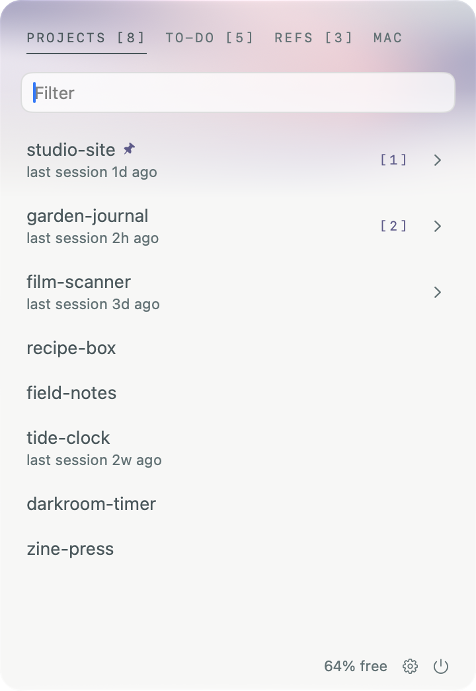
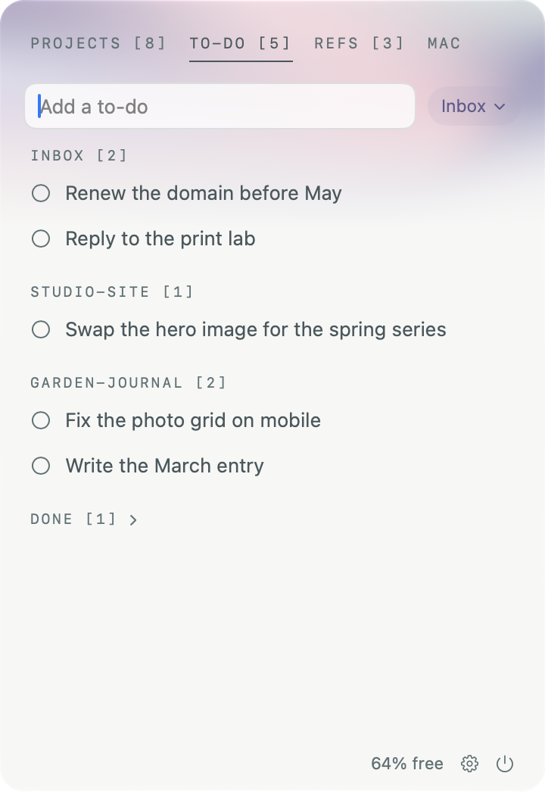
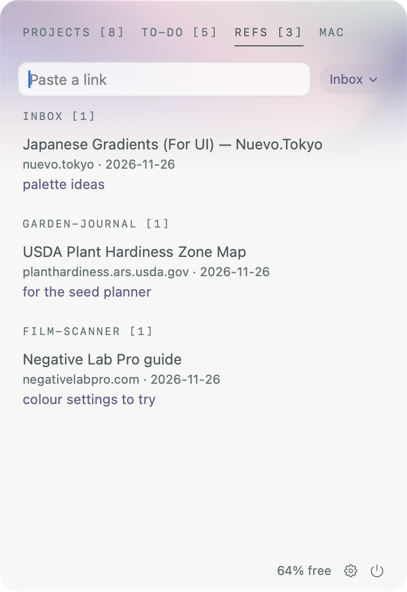
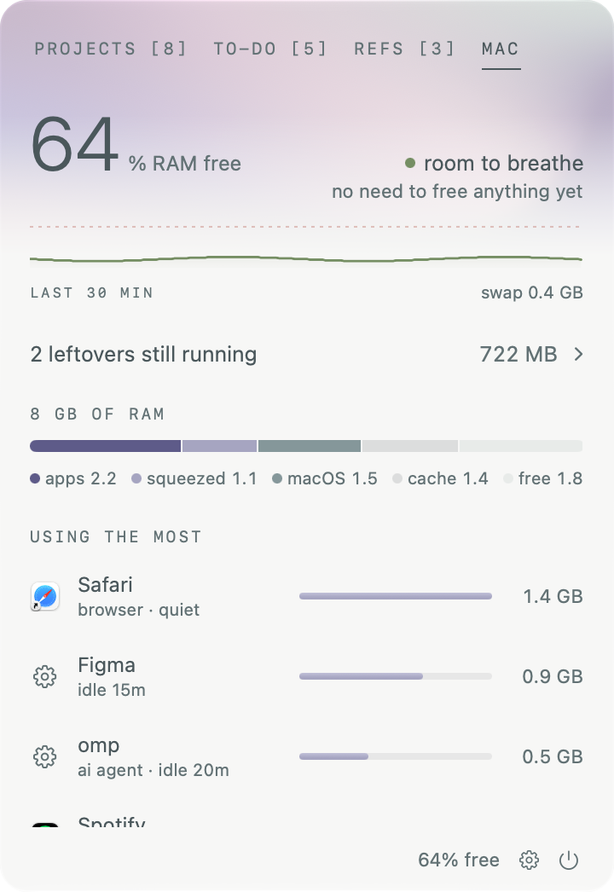
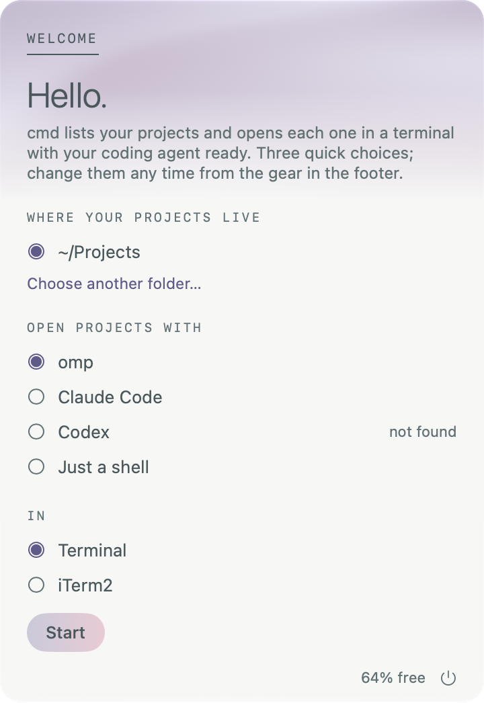

# cmd

A calm menu bar app for your Mac. Your projects sit one click away from a coding agent, with a to-do list and saved links that the agents can read, and a quiet eye on RAM and disk.


| Projects | To-do |
|---|---|
|  |  |
| **Refs** | **Mac** |
|  |  |

*All screenshots use made-up projects, notes and numbers (see "Updating the screenshots" below).*

## What does it do?

- **Projects.** Lists every folder in your projects folder, with the newest activity first. Click one to open it in Terminal or iTerm2 with your coding agent started. If the agent has an earlier session there, cmd continues it. Right-click to pin a project to the top, start a fresh session, or open it in Finder.
- **To-do.** Type a to-do and press Return. It goes to the Inbox, or to a project if you add `@name` (for example, `fix the photo grid @garden`). Tick items off; done items stay visible for a week.
- **Refs.** Paste a link and press Return. cmd fetches the page title. Any words after the link become a note.
- **Mac.** Free RAM in the menu bar, and the stuff quietly eating it: dev servers an agent left running, idle apps, and processes stuck burning CPU, each freed in one click. Dev junk on disk (old builds, package caches) can be cleared the same way. This part is built on [baa](https://github.com/selviarora/baa) by Selvi Arora.

The sun in the menu bar turns amber when RAM gets tight and red when it's critical.

## What do I need?

- macOS 15 or later.
- Apple's Command Line Tools. If you don't have them, run `xcode-select --install`. Full Xcode is not needed.
- Terminal (built in) or iTerm2.

## How do I install it?

```sh
git clone https://github.com/mackiec/daily-cmd.git
cd daily-cmd
./install.sh
```

That builds `cmd.app` into `~/Applications`, starts it, and sets it to start at login. Look for the sun in your menu bar.

The first time you open it, cmd asks three things:

1. Where your projects live. It offers the code folders it finds, or you can choose another.
2. Which agent to open projects with.
3. Which terminal to use.



You can change these any time from the gear in the panel's footer.

## Which agents work, and how?

| Agent | Opens with | Continues the last session | Shows "last session 2d ago" |
|---|---|---|---|
| omp | `omp` | `omp -c` | yes |
| Claude Code | `claude` | `claude -c` | yes |
| Codex | `codex` | no (starts fresh) | no |
| Just a shell | your shell, in the project folder | — | — |

cmd reads the session times from each agent's own session folders. Codex files its sessions by date rather than by project, so cmd can't tell which ones belong to a project.

## What will macOS ask permission for?

- **Automation.** The first time you open a project, macOS asks whether cmd may control Terminal (or iTerm2). cmd needs this to open a window in the project and start the agent.
- **Notifications.** cmd warns you when RAM or disk gets low, with a one-click Free or Clear button.

cmd never asks for, or looks in, Desktop, Documents, Downloads, Pictures, Music or Movies.

## What does it write, and where?

| What | Where |
|---|---|
| Inbox to-dos and links | `~/.cmd/todo.md`, `~/.cmd/refs.md` |
| A project's to-dos and links | `<project>/.cmd/todo.md`, `<project>/.cmd/refs.md` |
| Keeping those out of git | adds `.cmd/` to `<project>/.git/info/exclude` (git's local-only ignore list, so there's nothing to commit) |
| Pointing agents at them | one line in `<project>/AGENTS.md`, created if missing. Turn this off in settings. |
| Settings | macOS defaults, domain `xyz.mackiec.cmd` |

The notes are plain Markdown, so you and your agents can edit them directly. cmd picks up changes the next time you open the panel.

cmd never frees memory, kills a process or deletes a file on its own; every one needs a click. Cleared junk goes to the Trash.

## How do I update or uninstall it?

To update:

```sh
git pull && ./build.sh
```

To uninstall:

```sh
launchctl bootout gui/$(id -u)/xyz.mackiec.cmd
rm -rf ~/Applications/cmd.app ~/Library/LaunchAgents/xyz.mackiec.cmd.plist
```

Your notes stay where they are. To remove them too, delete `~/.cmd` and each project's `.cmd/` folder, then run `defaults delete xyz.mackiec.cmd`.

## Working on cmd

- It's a native SwiftUI app with no dependencies, built by `swiftc` from `build.sh`. See `technical-constraints.md` for the layout and the reasons behind it.
- `product-principles.md` and `ux-flows.md` are the design notes the app was built from.
- `tools/shot.sh /tmp/cmd.png 1 2 3 4` captures each tab of the running app, for checking UI changes.

### Updating the screenshots

Run `tools/readme-shots.sh`. It builds a throwaway home folder with made-up projects and notes, and runs the installed app in demo mode (`CMD_DEMO=1`). Demo mode uses its own settings and invented RAM and disk numbers, and it can't free or clear anything. The script stops your normal cmd while it runs and starts it again afterwards. Both scripts need Accessibility permission for your terminal.

## Credits

- The Mac tab's leftover detection, disk cleanup and alerts come from [baa](https://github.com/selviarora/baa) by Selvi Arora (MIT; see `NOTICE`).
- The colours and gradients are inspired by Nuevo.Tokyo's *Japanese Colours* and *Japanese Gradients [For UI]*.

## Licence

MIT. See `LICENSE`.
